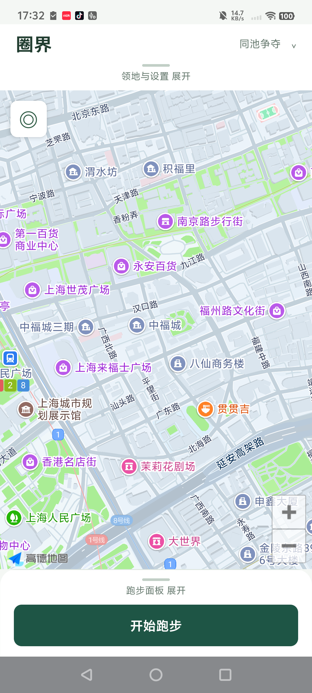
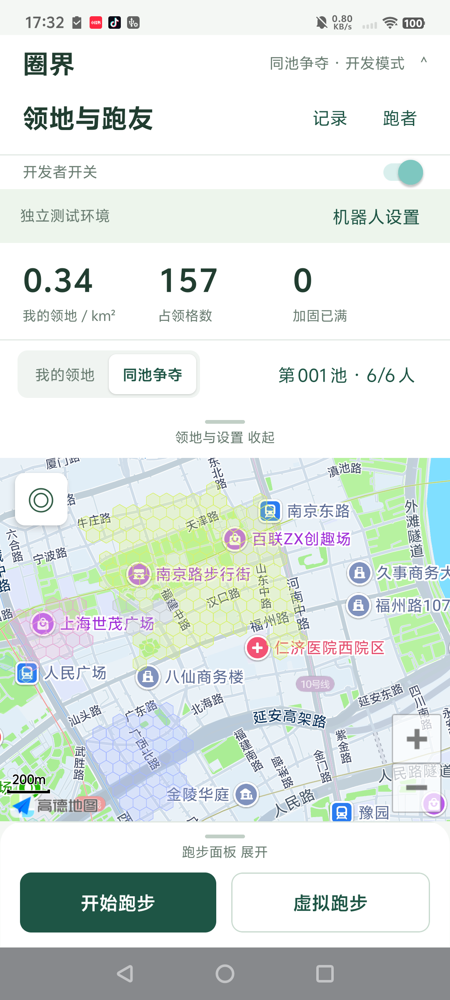
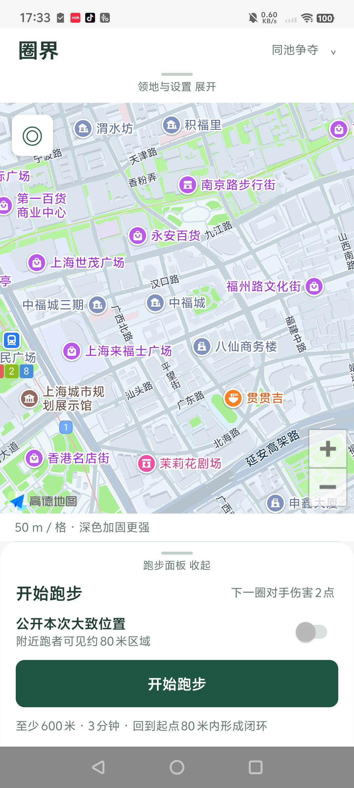
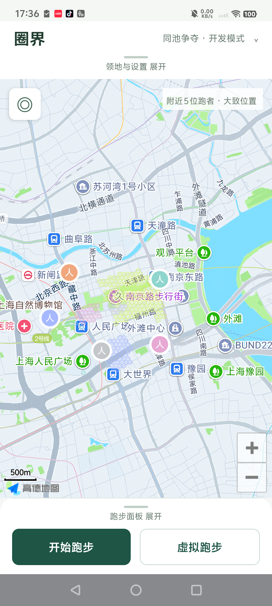
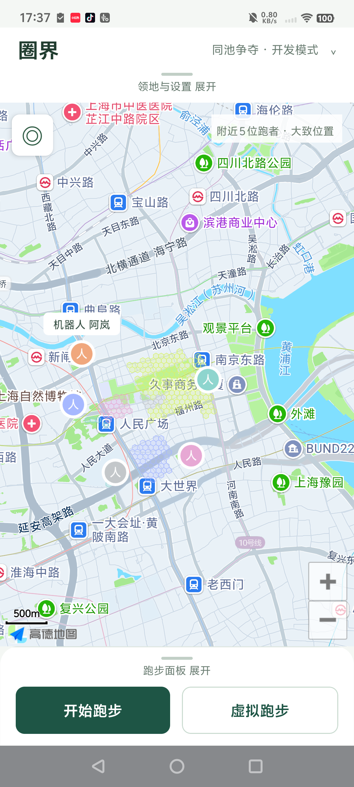
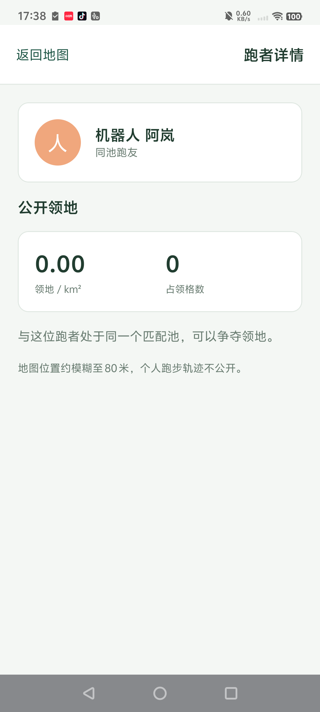
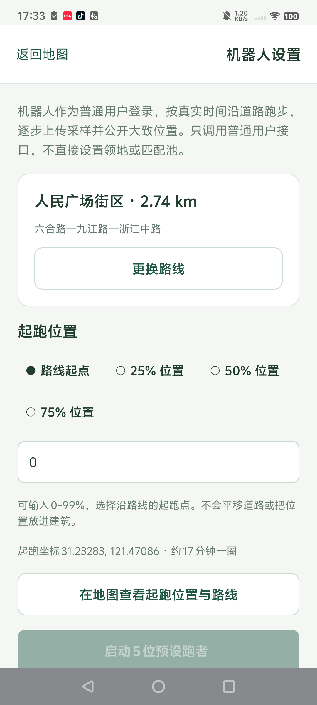
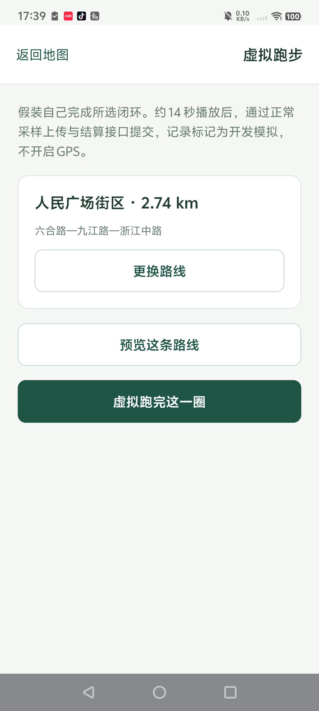
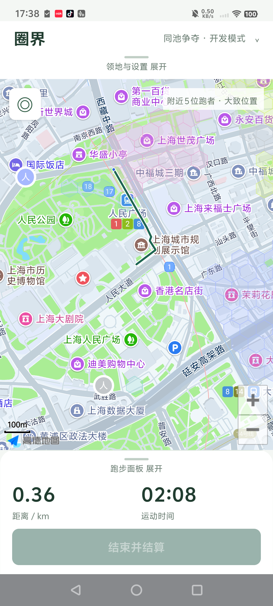
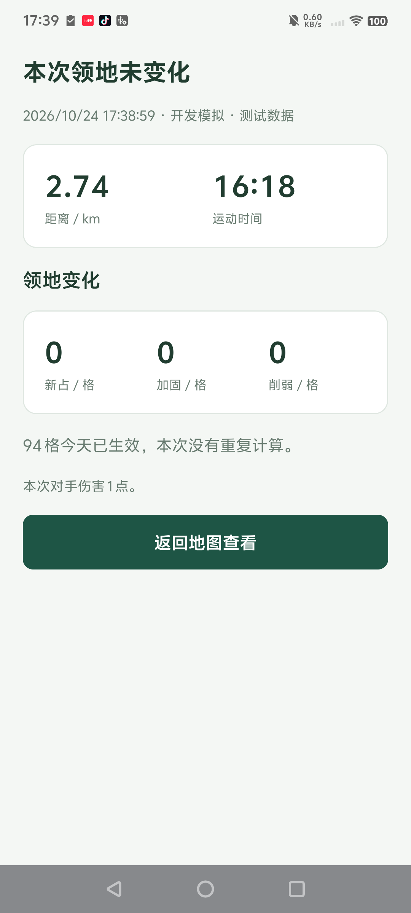

# 圈界 LoopRun 产品文档

| 项目 | 内容 |
| --- | --- |
| 产品阶段 | Android 内测 |
| 功能基线 | 0.6.0 |
| 更新日期 | 2026 年 10 月 27 日 |
| 状态 | 讨论稿，当前功能与规则按现有实现描述；新增需求列入待确认事项 |

## 产品定位

圈界是一款把真实跑步与小范围领地争夺结合的 Android 应用。用户通过跑步围出闭环，将圈内区域变成自己的领地，再与在同一区域跑步的用户争夺、加固这些领地。

核心体验是“出门跑一圈，回来看到地图发生变化”。地图是主要操作界面，运动记录与领地结果形成反馈；同池跑友提供持续竞争对象。普通用户始终使用真实 GPS 跑步，模拟路线和机器人用于独立的联机开发环境或本地演示。

### 目标用户与使用场景

首轮面向已有跑步习惯、活动范围相对固定的用户，例如经常在住处、公园或工作地附近跑步的人。

| 场景 | 用户希望完成的事 | 产品提供的反馈 |
| --- | --- | --- |
| 日常跑步 | 完成附近的一条闭环路线 | 距离、时间及本次领地变化 |
| 查看地图 | 看自己拥有哪些区域 | 我的领地、面积、格数和加固状态 |
| 与跑友竞争 | 在真实重叠区域争夺领地 | 同池领地、面积排名、削弱与占领结果 |
| 观察附近跑者 | 知道周围是否有人正在跑步 | 经对方主动分享的大致位置 |
| 开发验证 | 在本机复现多人运动和地图变化 | 虚拟跑步、预设路线、机器人用户 |

### 当前范围

当前交付入口为 Android App。联机内测账户通过服务器地址和邀请口令连接。本地演示直接在手机创建独立世界，无需业务服务器。

## 当前完整性与双手机测试

当前状态为核心玩法已实现的 Android 内测版，尚未完成正式发布验收。联机模式下，两台手机不在本机各算一份领地，而是由同一个服务保存账户、匹配池、活动和领地，结算后另一端会刷新同池状态。

| 能力 | 当前状态 | 验证边界 |
| --- | --- | --- |
| Android 真实跑步、采样上传与结算 | 已实现 | 真实 GPS 长时户外及不同机型仍需验证 |
| 多账户占领、加固、削弱和匹配 | 已实现，共用服务端规则 | 有规则和接口测试；开发库有机器人普通 GPS 接口结算记录，不能等同于双手机户外实测 |
| 附近位置与人物详情 | 已实现 | 已用一台真机及机器人用户演示 |
| 本机安装、地图与开发工具 | 已验证主要流程 | 当前连接的实机为 vivo V2203A |
| 两台真机户外互相争夺 | 待验收 | 尚无两台设备完成真实 GPS 闭环并互相影响的实测记录 |
| 正式账户与发布环境 | 尚未完整交付 | 账户找回、跨设备使用及持续可用的部署方案待确认 |

### 两台手机什么时候会互相影响

需要同时满足以下条件：

1. 使用不同账户，并连接同一个服务地址和数据环境。普通环境和开发环境相互隔离，不能跨环境争夺。
2. 两个用户进入同一匹配池，且池未满。本次开发演示池已有本人及 5 位机器人，不适合再把第二台手机加入同一池。
3. 初次匹配的闭环有部分地域重叠，当前重叠比例需大于 0、小于 95%。两个人完全跑同一个圈，不保证进入同一池。
4. 两次跑步均满足距离、时间、闭环、定位采样等条件，并完成上传和结算。地图上看见对方不等于已经同池。
5. 结算的格子有实际重叠，且该用户当天尚未对这些格子生效；仅在附近跑步或重复当天已生效的路线，不一定产生变化。

满足条件后，第二位用户圈内的中立格可以归其所有，对第一位用户拥有的格子产生削弱。削弱至 0 时先转为中立，本次不直接抢占；再次占领仍需满足每日额度。第一位用户随后可在同池地图和统计中看到结果，通常由结算事件触发刷新，前台也有约 15 秒的状态轮询。

### 建议的双机实测步骤

1. 先准备两台手机均可访问的同一普通服务、有效内测口令和两个独立账户，两端均关闭开发者模式。
2. 在同一区域选择两条有明显部分重叠、但不完全一致的闭环路线。先由 A 完成有效跑步并记录其池编号、领地格数和结算结果。
3. B 完成有部分重叠的有效闭环后，确认两端池编号一致。若未同池，不把此次测试记为争夺成功。
4. 对照 B 的新占、削弱与转中立数量，以及 A 端领地和格子的变化。后续反击选取当天尚未消耗额度的区域，避免把每日限制误判为故障。
5. 若同时测试附近位置，两端开始前主动开启公开大致位置，并保持网络可用；观察匿名或同池姓名、约 80 米模糊位置及停止后的消失行为。
6. 单独检查锁屏记录、途中断网补传、应用中断与两端先后结算。这些结果另行记录，不用模拟截图代替。

本机默认服务绑定 127.0.0.1，依赖 USB 转发供连接手机访问；这不是可直接带出门使用的公网部署。局域网测试可使用手机能访问的内网服务地址，公网远程服务需要 HTTPS。户外实时多人体验应使用两台手机持续可访问的服务；离线记录回网后结算与实时看到对方属于不同测试条件。

## 核心体验

用户连接账户并了解地图与位置用途后，在地图上查看领地，开始真实跑步。结束时提交轨迹，系统检查闭环并结算占领、加固或削弱。用户在结果页理解本次变化，再返回地图查看，或进入记录页回看自己的轨迹。

1. 进入地图，展开抽屉查看领地和跑步选项。
2. 选择是否公开本次大致位置，点击“开始跑步”。
3. 使用真实 GPS 记录轨迹，跑出满足条件的闭环。
4. 点击“结束并结算”，上传采样并计算领地变化。
5. 阅读结算结果，在地图上查看新状态。
6. 后续通过新的闭环占领、加固或争夺领地。

首次有效闭环同时承担入池与初次领地结算。未找到适合对手时可以先独立成池，等待后续有重叠跑步区域的用户加入。

## 首页与地图

### 页面结构

地图占据首页主要空间。上下两部分使用可收起抽屉，默认均收起；用户可点击把手或上下拖动把手操作，最多展开一个。安卓返回键优先收起当前展开的抽屉。

| 区域 | 收起时 | 展开时 |
| --- | --- | --- |
| 上方抽屉 | 产品名称、当前地图模式、开发模式标记（仅开启时）及把手 | 我的领地统计、我的领地与同池争夺切换、同池跑友、记录、设置、开发者开关；开发模式增加机器人设置 |
| 地图 | 底图、已有归属的领地、符合分享条件的附近人物、回定位和缩放控件 | 始终可以操作剩余可见地图区域 |
| 下方抽屉 | 未跑步时保留开始跑步按钮；跑步时保留距离、时间及结束或重试操作 | 大致位置分享选项、规则提示；跑步中显示更多状态、距起点距离、同步情况及放弃操作 |

开发模式下，“虚拟跑步”与真实 GPS“开始跑步”并排。正常跑步主流程始终保留。

### 地图操作与领地展示

地图支持拖动平移和缩放。抽屉手势限定在把手区域；附近人数提示不拦截地图触摸。回定位按钮位于左上角，回到当前跑步位置或已有领地区域；没有可用位置时使用默认地图区域。缩放按钮位于右下角。

地图提供两种视角：

- 我的领地：查看本人拥有的格子。
- 同池争夺：查看当前匹配池中的领地归属。

领地以六边形格子呈现，对边目标为 50 米。颜色对应所有者，加固程度影响颜色深浅。只绘制有归属的格子，中立区域不绘制网格边线或底色。中立状态依然参与结算，隐藏网格不改变占领规则。

点击已绘制领地可以查看归属与加固信息。地图按当前视野加载领地，达到展示上限时提示用户放大查看。历史轨迹和开发路线可以临时预览，并通过提示条收起。

地图不放置悬浮隐私政策按钮。首次地图用途说明与设置页保留地图服务说明和政策入口；底图自身标识及审图信息保留。

### 附近人物与详情

只显示附近 3 km 内主动分享且位置仍有效的跑者，约每 5 秒刷新。公开位置模糊至约 80 米，不因领地格子更细而提高公开位置精度。

默认只显示人物图标。第一次点击人物显示名字，第二次点击同一人物或名字打开详情；点击地图空白处收起名字。

| 关系 | 地图选中后 | 详情页 |
| --- | --- | --- |
| 同池跑友 | 显示名字和对应颜色 | 名字、颜色、同池关系、公开领地面积与占领格数 |
| 非同池跑者 | 显示“附近跑者” | 匿名身份及位置分享说明，不展示姓名、领地统计或私有轨迹 |

停止活动、停止分享或位置过期后，人物从附近图层移除。位置有效期为 35 秒。原始 GPS、起终点和历史轨迹不提供给其他用户。

## 跑步流程与异常处理

### 开始与记录

开始跑步需要联网取得活动编号；同一用户不能同时进行多场活动。用户主动点击开始后请求所需定位及通知权限，以持续通知提示正在记录。

开始前，“公开本次大致位置”默认关闭，用户可以选择开启。普通跑步由本机记录真实定位，轨迹先保存在本机，再上传服务端。

首版没有暂停后拼接轨迹的产品流程，不把不同活动合并成一圈。服务中断、定位异常或较长采样间断必须反映为真实状态，不能补造轨迹。

### 有效闭环条件

以下条件需要同时满足：

| 条件 | 当前参数 |
| --- | --- |
| 有效采样点 | 8 至 6000 个 |
| 跑步距离 | 至少 600 米 |
| 有效采样时长 | 至少 3 分钟 |
| 首尾距离 | 不超过 80 米 |
| 圈内格子 | 至少 4 格，最多 12000 格 |
| 单点定位精度 | 不超过 80 米 |
| 相邻采样间隔 | 时间递增，间隔不超过 90 秒 |
| 相邻点速度 | 不超过 10 米每秒 |
| 全程平均速度 | 不超过 7 米每秒 |

以格子中心是否被有效闭环包围确定圈内格子。自交路线和子闭环按去重后的圈内格子计算；反复绕同一圈不会扩大计数。这些检查属于基础异常识别，不代表已解决 GPS 伪造问题。

### 结束与结算

结束后停止采样并保留结束时间，全部采样上传完成后请求结算。同一活动重试提交只返回同一结果，不重复占领或攻击。

结果页展示距离、时间、新占格数、加固格数、削弱格数，以及适用的转中立、当天已生效和加固已满说明。没有新增格子不等于跑步失败：可能只发生加固或削弱，也可能所有格子都已使用当天额度。

领地变化、每日额度和伤害按实际结算时状态计算；跑步有效性按活动的采样与结束时间检查。跨日补传不能自行指定结算日期。

### 断网与中断

| 情况 | 用户看到的行为 |
| --- | --- |
| 开始前没有网络 | 无法创建活动，不进入正式记录流程 |
| 跑步途中断网 | 继续保存本机轨迹，恢复网络后补传 |
| 上传或结算失败 | 保留本机数据和状态，提供重试或对应处理操作 |
| 记录被中断 | 明确显示中断，不把缺失部分补成连续轨迹 |
| 轨迹不满足规则 | 提示原因，不产生领地变化 |
| 用户放弃活动 | 确认后取消本次活动，不结算领地 |
| 活动超时 | 活动最多保留 12 小时用于上传与结算，超时按取消处理 |

## 领地争夺规则

### 三种主要效果

| 圈内格子原状态 | 本次效果 |
| --- | --- |
| 中立 | 归当前用户所有，加固值为 1 |
| 自己拥有 | 加固值加 1，上限 3 |
| 对手拥有 | 扣除伤害；降至 0 时转为中立，本次不直接转为自己的领地 |

普通伤害为 1。首次有效跑步，或距离上次有效跑步已满 72 小时，首个有效闭环对对手格子造成 2 点伤害；占领与加固不翻倍。该机会随有效跑步完成而消耗，不储存、不叠加，无效活动不消耗。

### 每日生效限制

同一用户对同一格，在北京时间同一天最多生效一次。这个限制同时作用于占领、加固和削弱，拆分活动、重复绕圈、开发模拟都不能绕过。

因此，把对手格子打成中立后，需要另一场满足额度条件的有效跑步才能占领。若当前用户当天已经削弱过该格，再跑一圈仍不会占领；通常需要到下一天再对该格生效。其他尚未消耗额度的用户可按各自规则参与争夺。

例如，同一天第一次围住 94 个中立格后，可新占 94 格；当天再次完整重复同一条路线，结果可能是新占、加固、削弱均为 0，并显示“94 格今天已生效”。第二天重复路线，如果格子仍属于自己且未加固满，则产生加固。

## 匹配池与跑友

每池最多 6 人，领地争夺与排名以当前池为范围，不同池互不影响。系统依据本次闭环与已有成员最近有效闭环的部分重叠寻找合适的池，不移动路线，不虚构地域重合。当前要求重叠比例大于 0 且小于 95%，比例按较小一方的格子数计算。

没有适合的池时创建新池；后续跑者满足地域与人数条件后可加入。同池跑友页按领地面积展示顺序，并显示格数和对应颜色。

好友邀请在服务端规则中提供入池优先，仍需真实地域重叠与空位，不提供数值奖励。当前 Android App 尚未提供好友邀请入口，不能作为已交付用户功能。

### 离开与重新匹配

- 连续 14 天没有有效跑步时，移出原池，仍属于自己的格子转为中立。
- 名下领地为零，且本次入池曾拥有的全部格子都归其他用户时，移出原池；只是变为中立不触发该清退条件。
- 离开后，下次有效跑步重新匹配，并排除刚离开的池。历史活动保留，旧池的领地、加固与对手关系不带入新池。
- 离开原池时，未完成活动不能继续向其他池结算。

## 记录与账户

记录页展示累计距离、有效闭环数、当前领地，以及最近完成的跑步记录。当前列表最多返回最近 30 场，完整历史分页待后续确定。记录详情可查看本次结算，并将本人历史轨迹显示在地图上。

当前内测使用设备随机凭据识别账户，昵称与邀请口令用于账户连接，本机凭据受系统密钥保护。清除应用数据会失去本机凭据；正式账户找回、换机和跨设备使用方案待确认。

## 本地演示

用于面试和单机体验。首页及设置提供“进入本地演示”，进入后主按钮变为“演示跑步”，另提供机器人设置与演示设置。此模式使用预设路线，不开启真实 GPS，也不需要服务地址或邀请口令；高德底图仍需联网。

- 选择道路闭环，约 14 秒播放后由用户结束结算，结果和历史明确标注本地演示。
- 从空世界开始，共用联机的匹配、闭环、占领、加固、削弱、每日额度与移池规则。
- 机器人使用相同的活动开始、逐点采样、位置分享和结算操作，按真实时间跑步，不直接设置领地。可启动 5 位预设跑者，也可定义路线与起跑百分比。
- 账户、活动、领地和轨迹原子写入手机文件，重启后保留；本人未完成的模拟活动可以恢复，机器人切到后台或重启后暂停。
- “重置演示”经确认后清空整个本地世界并创建新身份，便于反复展示；退出保留演示数据，恢复原来的联机配置。
- 切换前处理本人的当前模拟活动和本机真实 GPS 活动。进入本地演示不依赖旧服务器在线。
- 每台手机各自保存本地世界；两台手机互相争夺使用联机模式。

## 联机开发者模式

### 开关与隔离

开发者模式默认关闭，可在首页上方抽屉或设置页开启。开启后使用独立测试账户与数据环境，界面明确显示开发模式，并增加虚拟跑步、机器人设置。关闭后恢复普通用户视角，不展示测试记录与测试工具。

切换联机普通与开发环境前必须处理正在进行或待上传的活动。无法确认服务器活动状态时不能静默切换，避免轨迹上传到错误环境。

### 虚拟跑步

用户选择一条预设道路闭环，约 14 秒完成播放，再通过正常采样上传与结算流程提交。记录明确标记为开发模拟，不开启真实定位。应用重启后可以恢复未完成的模拟活动并继续处理。

虚拟跑步遵守同样的匹配、占领、加固、削弱、每日额度及移池规则。加速播放不改变服务器日期，也不恢复当天已使用的格子额度。

### 机器人用户

机器人用于模拟其他用户，而非地图装饰或后台预置领地。

- 通过普通用户登录取得身份，再开始跑步、上传采样、分享大致位置并结束或取消活动。
- 按真实时间沿预设道路路线前进，不能瞬间提交一整圈过去的运动；当前速度为 2.8 米每秒。
- 可指定单个机器人的路线及沿路线 0 至 99% 的起跑位置，并提供 0、25、50、75% 快捷位置。
- 可启动 5 位预设跑者，按各自计划运行，每位最多 4 圈；也可暂停全部机器人。
- 地图复用普通用户的附近位置展示，不能从机器人工具取得精确位置直接绘制。
- 不直接修改数据库、领地、加固或匹配结果，不绕过每日限制；独立测试环境中的互动按真实业务规则发生。

## 实机演示

以下画面于 2026 年 10 月 24 日通过 USB ADB 从 vivo V2203A 截取，App 版本为 0.5.2，保留原始屏幕画面。普通首页与普通跑步选项使用普通环境；有领地、机器人及虚拟跑步的画面使用独立开发环境。图中的距离、时间与领地数据不能作为两台手机户外真实跑步的验证结果。

### 首页与抽屉

左图为普通用户首页：地图占据主要空间，底部只有真实跑步入口，没有虚拟跑步和机器人入口。右图为上方抽屉展开后的开发环境，集中展示领地统计、地图模式、同池人数及开发者开关。

| 普通用户首页 | 上方抽屉 开发环境 |
| --- | --- |
|  |  |

### 跑步选项与多人地图

左图展开普通环境的下方抽屉，显示位置分享开关和闭环要求。右图为开发环境中的 5 位机器人用户：人物默认不展示名字，已有归属的领地显示颜色，中立区域没有网格。附近人物通过普通用户位置接口展示，画面不代表同时连接了 5 台手机。

| 普通跑步选项 | 机器人多人地图 开发环境 |
| --- | --- |
|  |  |

### 点击人物查看公开详情

左图第一次点击人物后出现“机器人 阿岚”的名字；右图再次点击名字进入对应跑者详情。这里展示的是同池用户的公开领地信息，不包含个人轨迹。两图均为开发环境。

| 第一次点击显示名字 | 再次点击进入详情 |
| --- | --- |
|  |  |

### 开发测试入口

机器人设置可以选择道路路线和沿路线的起跑位置；虚拟跑步选择本人要模拟完成的闭环。两者均为开发工具，不出现在关闭开发模式的普通用户界面。

| 机器人路线与起点 | 本人虚拟跑步路线 |
| --- | --- |
|  |  |

### 跑步状态与结算解释

左图演示模拟路线播放中的地图和收起的跑步面板，仍保留距离、时间与结束按钮；播放未完成时按钮不可用。右图为这次模拟跑步的实际结算页，明确标注“开发模拟”。当天相同 94 格已经生效，因此三个变化指标均为 0，并显示原因。这是每日额度规则的演示，不是结算失败，也不表示本轮新占领了 94 格。

虚拟路线约 14 秒播放，画面中的运动时间来自模拟路线的采样时间，不等于拍摄时实际跑了相同时间。

| 模拟跑步中 | 当天重复路线的结算 |
| --- | --- |
|  |  |

## 验收重点与验证状态

### 功能验收口径

| 项目 | 期望结果 |
| --- | --- |
| 普通用户视角 | 默认关闭开发模式，真实跑步入口可用，测试控件不出现 |
| 首页空间 | 抽屉收起时地图是主体，展开和收起不影响活动记录 |
| 地图手势 | 可见地图可拖动与缩放，抽屉把手不会占用地图区域手势 |
| 中立区域 | 无边线、无底色；转中立后相应领地绘制消失 |
| 人物交互 | 默认无名字，选中显示名字，再次点击进入对应详情 |
| 有效跑步 | 满足全部条件后结算，重复请求不产生重复效果 |
| 结果解释 | 区分新占、加固、削弱、每日额度和无效轨迹 |
| 数据隔离 | 关闭开发模式后，普通账户不会混入测试记录 |
| 隐私 | 默认不分享位置；分享后仅公开大致位置与允许的公开资料 |
| 断网与恢复 | 记录与状态保留，失败可处理，不伪造缺失轨迹 |

### 当前验证事实

已进行 Android release 构建、类型检查、lint、签名及安装包对齐检查，并在连接的 vivo V2203A 真机上验证了抽屉、地图横纵拖动、缩放按钮、人物选中与详情、虚拟跑步结算，以及普通和开发模式的界面隔离。道路采样与机器人普通接口流程有本机验证。

本次只读核对开发库，已有 20 场机器人通过普通 GPS 接口完成的活动，采样时长约 17.6 至 21.6 分钟；实际结算时间均晚于对应完整跑圈时长。累计新占 1 格、削弱 0 格，有 2888 次格子判定因当天已生效而跳过。这补充了真实时间机器人完成采样与结算的运行事实，不能作为手机真实定位或双机争夺的验收记录。

户外真实 GPS 的长时间稳定性、锁屏、耗电、弱网及机型覆盖仍需专项验收。双手机真实 GPS 争夺尚未验收；机器人完整真实时长跑圈结算也不能用快速模拟或路线校验替代。以上功能存在不代表已完成公开发布验收。

### 0.6.0 本地演示验证

本地规则测试覆盖首次占领、每日跳过、机器人多人匹配与削弱、采样重试、持久化恢复、失败写入回滚和重置。AppProvider 集成测试在 HTTP 和 WebSocket 均禁止的条件下，完成进入演示、路线恢复、结算、历史、退出与重置；原生存储边界使用测试替身。联机账户隔离、上传重试和六人机器人回归测试通过。Android release 构建、签名与 16 KB ZIP 对齐检查通过，版本为 0.6.0 / 8。新版本先交付 APK，实机安装验收随后进行；上方截图仍是 0.5.2 的真实记录。

## 后续待确认

以下内容尚未形成实施承诺，不改变前述当前规则。

| 事项 | 需要确认的问题 |
| --- | --- |
| 结算解释 | 当没有新占领时，是否增加更醒目的原因摘要，并在重复路线开始前提示每日额度？ |
| 正式账户体系 | 使用何种登录方式，如何找回、换机与处理数据删除？ |
| 好友邀请 | 安卓入口、邀请失败后的用户选择，以及匹配条件如何解释？ |
| 跨池信息 | 非同池用户未来可看哪些公开信息，是否仍保持匿名？ |
| 历史记录 | 是否增加分页、日期筛选及更完整的运动统计？ |
| 地区扩展 | 默认城市、无领地时地图定位体验，以及扩展地区的网格尺度验证如何安排？ |
| 规则体验 | 每日同格一次、72 小时回归伤害与14天移池，是否符合真人内测反馈？ |

## 产品效果观察

以下为建议观察指标，当前不表示已有完整统计看板，也不设未经确认的目标值。

- 激活：连接账户后，完成首次真实有效闭环的用户比例。
- 运动完成：开始活动后完成有效结算的比例，并区分用户放弃、定位异常、规则不满足和上传失败。
- 多人体验：首次有效闭环后，用户进入有其他跑者的池所需时间与比例。
- 持续使用：用户后续 7 天、14 天的真实有效跑步频次与回访。
- 结果理解：对“没有新占领”等结果的疑问、重试与反馈情况。
- 可靠性：采样间断、上传重试、结算失败、异常中断与耗电表现。

统计普通用户效果时，应排除开发模拟与机器人数据，并避免收集公开展示不需要的精确轨迹信息。

## 维护依据

当前规则参数以 shared/config.mjs、shared/geo.mjs 与 shared/game.mjs 的实现为依据；玩法说明见仓库 docs/规则.md，环境和隐私边界见 docs/接入与部署.md。服务端通过 server/game.mjs 适配同一规则引擎，本地演示通过 shared/local-demo.mjs 调用。

后续确认新设计时，应同步替换本说明和相关规则中的被替代表述，避免在多个文档中保留相互冲突的现行规则。验证结果单独记录，不因设计变更改写为已验收。
